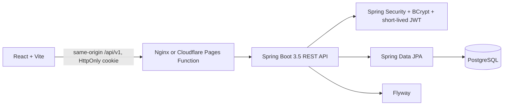
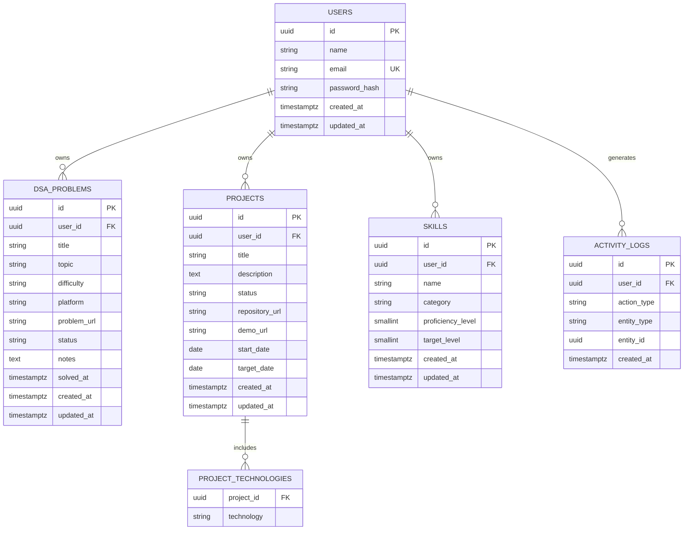

# DevTrack architecture

## Service layout

The API is a modular monolith. Controllers validate HTTP input and call services; services enforce rules and ownership; repositories perform persistence. API responses are DTOs, never JPA entities.

## Database ER diagram

## Security decisions

- The client never supplies an owner ID. Every private service call receives the UUID from the validated security principal.
- Passwords use BCrypt; credentials and JWTs are never written to logs or browser storage.
- The access JWT expires after 15 minutes by default and is stored in an HttpOnly, SameSite cookie.
- Production must use HTTPS, `COOKIE_SECURE=true`, a dedicated 32-byte-or-longer `JWT_SECRET`, and exact allowed origins.
- CORS is credential-aware and uses explicit origins, not `*`.
- Record lookups combine record ID and current user ID so a foreign ID returns 404.
- Flyway owns schema changes; Hibernate validates the schema at startup.

## Source of truth

- API contract: `lib/api-spec/openapi.yaml`
- Database migration: `backend/src/main/resources/db/migration/`
- Backend: `backend/src/main/java/com/devtrack/`
- Frontend: `artifacts/devtrack/src/`
